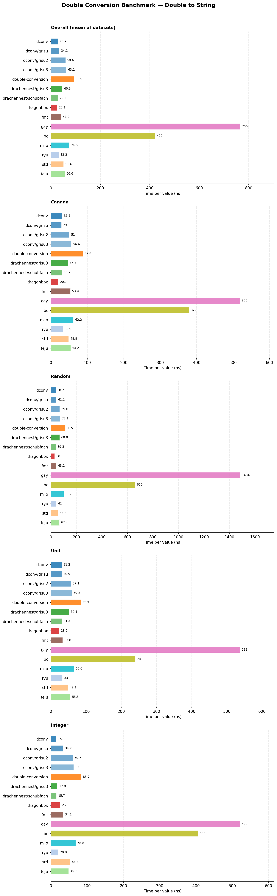
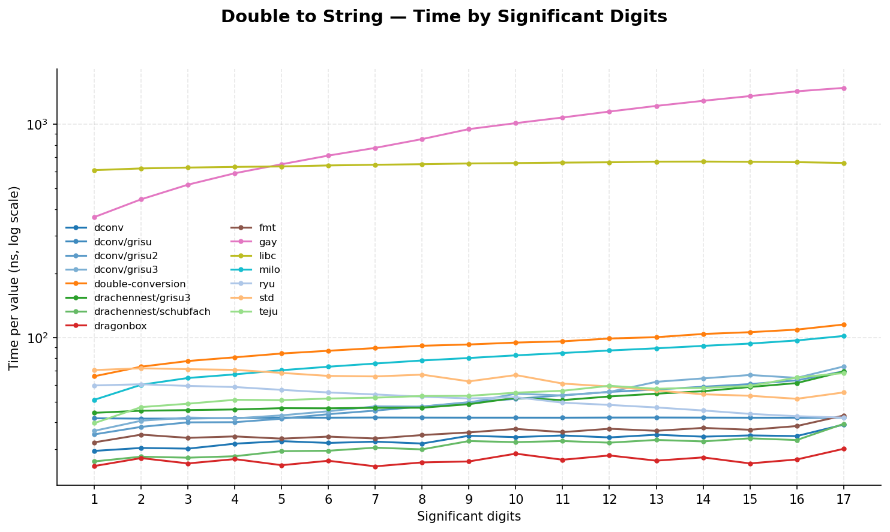
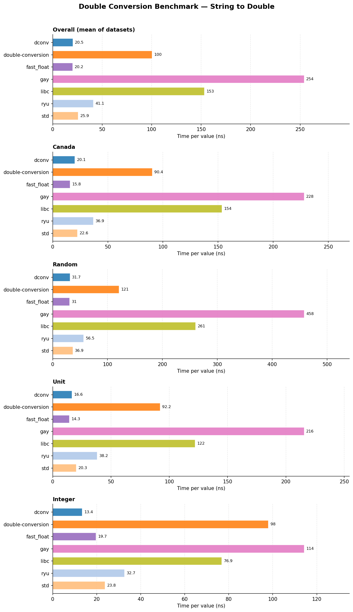
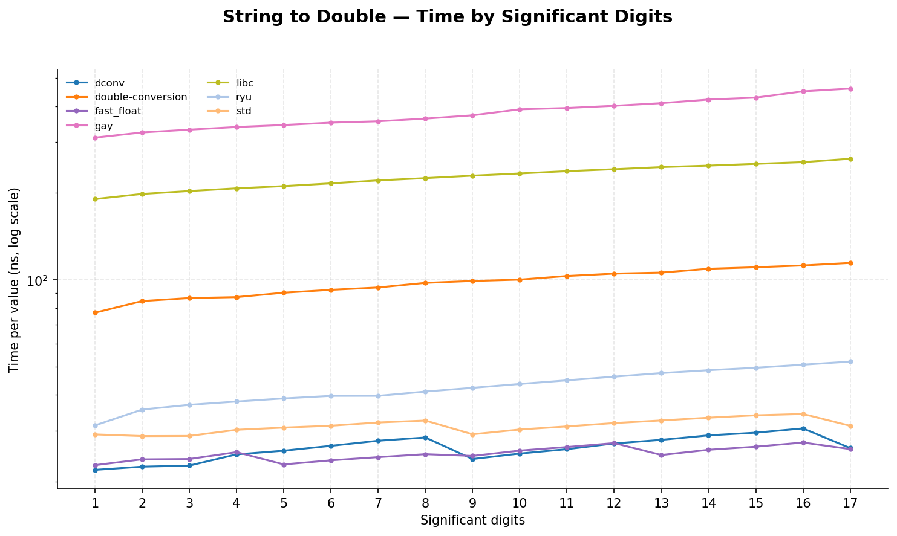
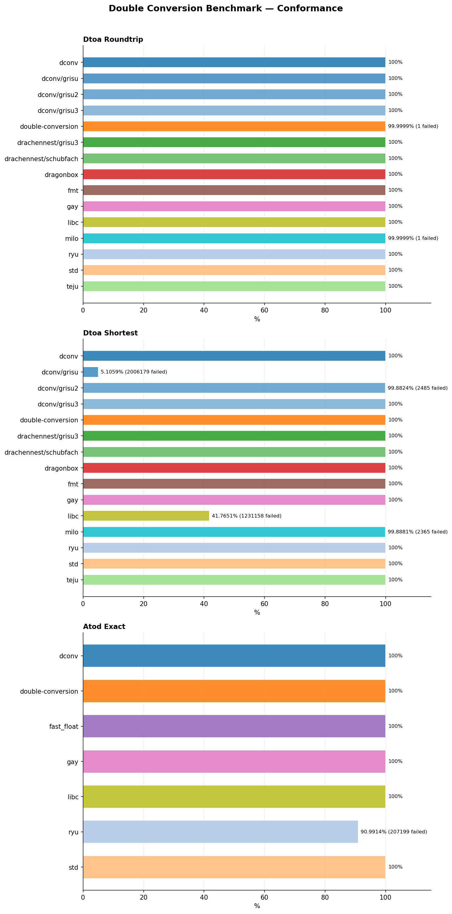

# dconv-benchmark

Comparative benchmarks of double conversion libraries in C++, measuring double to string (`dtoa`) and string to double (`atod`) performance on generated and real-world datasets. Includes a conformance suite covering roundtrip, shortest output and correctly rounded parsing.

Largely inspired by [dtoa-benchmark](https://github.com/miloyip/dtoa-benchmark) by Milo Yip.

## Table of contents

- [Libraries](#libraries)
- [Datasets](#datasets)
- [Build](#build)
- [Running benchmarks](#running-benchmarks)
- [Plots](#plots)
- [What the benchmarks measure](#what-the-benchmarks-measure)
  - [Dtoa](#dtoa)
  - [Atod](#atod)
  - [Conformance](#conformance)
- [Notes](#notes)
- [Test machine](#test-machine)
- [Results](#results)
- [License](#license)

## Libraries

| Library | Version | Dtoa | Atod | Algorithm |
|---------|---------|:----:|:----:|-----------|
| [dconv](https://github.com/joinframework/dconv) | v1.1.0 | ✓ | ✓ | Schubfach / Eisel-Lemire with strtod fallback |
| [dconv](https://github.com/joinframework/dconv) grisu | v1.1.0 | ✓ | | Grisu |
| [dconv](https://github.com/joinframework/dconv) grisu2 | v1.1.0 | ✓ | | Grisu2 |
| [dconv](https://github.com/joinframework/dconv) grisu3 | v1.1.0 | ✓ | | Grisu3 with `std::to_chars` fallback |
| [double-conversion](https://github.com/google/double-conversion) | v3.4.0 | ✓ | ✓ | Grisu3 with bignum fallback / Clinger with bignum fallback |
| [Drachennest](https://github.com/abolz/Drachennest) grisu3 | e6714a3 | ✓ | | Grisu3 with Dragon4 fallback |
| [Drachennest](https://github.com/abolz/Drachennest) schubfach | e6714a3 | ✓ | | Schubfach |
| [Dragonbox](https://github.com/jk-jeon/dragonbox) | 1.1.3 | ✓ | | Dragonbox |
| [fast_float](https://github.com/fastfloat/fast_float) | v8.3.2 | | ✓ | Eisel-Lemire with bignum fallback |
| [fmt](https://github.com/fmtlib/fmt) | 12.2.0 | ✓ | | Dragonbox |
| [David Gay](https://www.netlib.org/fp/) `dtoa.c` | netlib | ✓ | ✓ | Steele & White / Clinger with bignum arithmetic |
| libc | glibc 2.43 | ✓ | ✓ | `snprintf ("%.17g")` / `strtod` |
| [Milo Yip](https://github.com/miloyip/dtoa-benchmark) | bf1fb58 | ✓ | | Grisu2 (the one used by RapidJSON) |
| [Ryu](https://github.com/ulfjack/ryu) | 4c0618b | ✓ | ✓ | Ryu / Ryu parse |
| std (libstdc++) | GCC 16 runtime (6.0.35) | ✓ | ✓ | `std::to_chars` (Ryu) / `std::from_chars` (fast_float) |
| [Tejú Jaguá](https://github.com/cassioneri/teju_jagua) | 4403283 | ✓ | | Tejú Jaguá |

## Datasets

Every dataset holds 65 536 values (except Canada) and is generated with a fixed seed, so all libraries see the same inputs.

| Dataset | Characteristics |
|---------|-----------------|
| `Canada` | the 111 126 numbers of `canada.json` (coordinates, 15 to 17 significant digits), parsed from their original text |
| `Random` | random 64-bit patterns, every finite double, all exponents; text in shortest scientific notation |
| `Unit` | uniform doubles in [0, 1); text in shortest notation |
| `Integer` | integers in [-2^53, 2^53]; text in shortest notation |
| `Digits01` … `Digits17` | random doubles rounded to 1 … 17 significant digits; text written with `%.{n-1}e` |

Each benchmark binary is run several times, each repetition in a new process. The time reported is the minimum across repetitions, per value (nanoseconds); the overall time is the mean over `Canada`, `Random`, `Unit` and `Integer`.

## Build

Configure:

```bash
cmake -B build -DCMAKE_BUILD_TYPE=Release
```

To benchmark a local dconv checkout instead of `main`:

```bash
cmake -B build -DCMAKE_BUILD_TYPE=Release -DFETCHCONTENT_SOURCE_DIR_DCONV=/path/to/dconv
```

Compile:

```bash
cmake --build build -j$(nproc)
```

## Running benchmarks

Run everything and generate plots:

```bash
bash scripts/run_bench.sh
```

With a local dconv checkout:

```bash
DCONV_SOURCE_DIR=/path/to/dconv bash scripts/run_bench.sh
```

Single binary (one per operation and adapter, `bench_<operation>_<adapter>`):

```bash
taskset -c 2 ./build/benchmarks/performance/bench_dtoa_dconv \
    --benchmark_format=json \
    --benchmark_out=results/dtoa_dconv.json \
    --benchmark_min_warmup_time=0.5
```

Conformance only:

```bash
./build/benchmarks/conformance/conformance --output results/conformance.json
```

> [!NOTE]
> Default: 3 repetitions per binary (`REPETITIONS`), each in a new process, minimum reported. Override with e.g. `REPETITIONS=5 bash scripts/run_bench.sh`. Raw per-repetition results are written to `results/runs/`.

## Plots

Install plotting dependencies, either from the distribution (Debian/Ubuntu):

```bash
sudo apt install python3-matplotlib python3-pandas
```

or in a virtual environment:

```bash
python3 -m venv .venv
.venv/bin/pip install -r plots/requirements.txt
```

Generate the charts:

```bash
python3 plots/plot.py results/conformance.json results/runs/*.json
```

Bars show the minimum across processes.

PNGs are written to `plots/`:
- `performance_dtoa.png` — double to string (overall + per dataset)
- `performance_atod.png` — string to double (overall + per dataset)
- `digits_dtoa.png` — double to string time by number of significant digits
- `digits_atod.png` — string to double time by number of significant digits
- `conformance.png` — dtoa roundtrip, dtoa shortest output, atod correct rounding

## What the benchmarks measure

### Dtoa

**Goal**: time to write a `double` to text, with each library's native API and output format.

Each iteration converts every value of the dataset into a 64-byte stack buffer. Libraries that produce the shortest representation (all but libc) are compared like for like; libc writes 17 significant digits with `%.17g`, which always round-trips but is not the shortest.

**What is measured**: the binary to decimal conversion and the formatting of the digits, exponent and sign.

---

### Atod

**Goal**: time to read a `double` from text, with each library's native API.

Each iteration parses every string of the dataset. Before timing, every string is checked once to be fully consumed by the library; a library that rejects an input of a dataset is reported as an error for that dataset instead of being timed.

**What is measured**: digit scanning, decimal to binary conversion and correct rounding.

---

### Conformance

Three correctness categories, run once (no timing), with `std::to_chars` and `std::from_chars` (correctly rounded) as references:

1. **Dtoa Roundtrip**: the output, read back with `std::from_chars`, must give the same double bit for bit. 2.2 M values: 1 M random 64-bit patterns, the 17 `Digits` datasets and special values (zeros, subnormals, extremes).
2. **Dtoa Shortest**: the output must not have more significant digits than the shortest representation. Same values.
3. **Atod Exact**: the parsed double must be bitwise equal to the correctly rounded value. 2.3 M strings: shortest and `%.17g` text of random doubles, long mantissas (18 to 40 digits), subnormals and known hard cases (halfway values, `9007199254740993`, the `2.2250738585072011e-308` boundary).

## Notes

- `-march=native`: CPU-specific optimisations. Results are not portable across machines.
- Each iteration is timed with the TSC (`rdtsc`, `cntvct_el0` on aarch64), calibrated over 20 ms at program startup, and reported to Google Benchmark as manual time.
- Each adapter is measured in its own binary (`bench_<operation>_<adapter>`), linked only against its library, so that the code layout of one adapter does not depend on the others.
- Each repetition runs in a new process, interleaved across libraries; the minimum across repetitions is reported, since noise only ever adds time.
- Each case warms up for 0.1 s (`--benchmark_min_warmup_time=0.1`) and is measured for at least 0.2 s (`--benchmark_min_time=0.2s`). Nothing is allocated in the timed loop, and one iteration already converts the whole dataset (65 536 values), so longer runs do not change the figures.
- Benchmarks are pinned with `taskset -c $BENCH_CPU` (default 2). `run_bench.sh` refuses to measure unless the governor is `performance` and boost is disabled, then waits until the CPU is back to its rated clock. `ALLOW_NOISY=1` overrides both checks.
- Every compiled library is linked statically.
- **Tejú Jaguá** only computes the decimal significand and exponent; its adapter writes them in scientific notation with a two-digit table, so its time includes this formatting.
- **David Gay**'s `dtoa.c` is built with `Long=int` (it assumes 32-bit `Long`) and `-fno-strict-aliasing`, and its `strtod` is renamed `gay_strtod`. Output comes from its `g_fmt` helper (mode 0, shortest).
- **Ryu**'s parser rejects mantissas longer than 17 digits (`INPUT_TOO_LONG`), which shows up in conformance only: every timed dataset stays within 17 digits.
- Result JSONs are gitignored (`results/`); plots are committed under `plots/`.

## Test machine

All figures below come from a single run on this machine (3 repetitions, each in its own process). They are not portable: `-march=native` alone makes them specific to this CPU.

| | |
|---|---|
| CPU | AMD Ryzen 7 2700X, 8 cores / 16 threads (Zen+), 1 socket, 1 NUMA node |
| Frequency | 3700 MHz, `performance` governor, boost disabled |
| Caches | L1d 8 × 32 KiB, L2 8 × 512 KiB, L3 2 × 8 MiB |
| RAM | 16 GiB |
| OS | Ubuntu 26.04.1 LTS, kernel 7.0.0-38-generic |
| Toolchain | GCC 15.2.0, glibc 2.43, libstdc++ runtime from GCC 16 (6.0.35), CMake 4.2.3 |
| Compile flags | `-O3 -DNDEBUG -march=native -std=c++20` |
| Pinning | `taskset -c 2` (physical core, SMT sibling 10) |
| Conditions | idle machine, 3 repetitions, run started once the CPU was back to its rated clock; spread across repetitions below 2% for 429 of 462 benchmarks and below 5% for 449; outliers are Milo Yip's Grisu2 (up to 14% on `Integer`) and dconv on short `Digits` datasets (up to 8%) |

## Results

Measured on a development machine. Re-run `scripts/run_bench.sh` to reproduce on other hardware; results are not portable across machines (`-march=native`).

### Double to string





**Dragonbox** leads at 25.1 ns per value, followed by **dconv** (28.9 ns, Schubfach), **Drachennest Schubfach** (29.3 ns) and **Ryu** (32.2 ns): these recent algorithms compute the shortest decimal significand with a few 128-bit multiplications, then print it, and their time barely depends on the number of digits (29.4 ns for one digit and 39.1 ns for seventeen with dconv). dconv is the fastest on integers (15.1 ns). **dconv Grisu** (34.1 ns) prints up to 18 digits without looking for the shortest output. **fmt** (41.2 ns) uses Dragonbox but pays for its formatting layer. **Drachennest Grisu3** (46.3 ns) is fast on integers (17.8 ns) but slower on random exponents. **std** (`std::to_chars`, 51.6 ns), **Tejú Jaguá** (56.6 ns), **dconv Grisu2** (59.6 ns) and **dconv Grisu3** (63.1 ns) form the next group; Grisu2 and Grisu3 generate the digits one by one (35 ns for one digit, about 70 ns for seventeen). **Milo Yip**'s Grisu2 (74.6 ns) and **double-conversion** (92.9 ns) follow. **libc** (`snprintf`, 422 ns) and **David Gay**'s `dtoa.c` (766 ns, up to 1.5 µs on random exponents, bignum arithmetic) are an order of magnitude slower.

Tejú Jaguá only provides the decimal significand and exponent: its figure includes the formatting written in its adapter, a plain division loop, and is likely pessimistic for the algorithm itself.

### String to double





**fast_float** (20.2 ns per value) and **dconv** (20.5 ns) lead, both using the Eisel-Lemire algorithm: dconv is faster on integers (13.4 ns against 19.7 ns), fast_float on `Canada` (15.8 ns against 20.1 ns) and `Unit` (14.3 ns against 16.6 ns). **std** (`std::from_chars`, 25.9 ns, built on fast_float in libstdc++) follows within 30%, then **Ryu** (41.1 ns). **double-conversion** (100.4 ns) is five times slower, then **libc** (`strtod`, 153 ns) and **David Gay**'s `strtod` (254 ns).

### Conformance



**Dtoa Roundtrip**: every library reads back to the same double, except one value each for **Milo Yip**'s Grisu2 and **double-conversion**, both on the sign of zero (`-0.0` written without its sign; ECMAScript, which double-conversion follows, prints `-0` as `0`).

**Dtoa Shortest**: **dconv** (Schubfach) is shortest on every value. Grisu2 does not always find the shortest output: **dconv Grisu2** writes one digit too many on 2 485 of the 2.1 M values (99.88%), **Milo Yip**'s Grisu2 on 2 365 (99.89%). Grisu3 detects these cases and falls back on a slower algorithm, in **dconv** and **Drachennest** alike; Dragonbox, Schubfach, Ryu and Tejú Jaguá are shortest by construction. **dconv Grisu** prints up to 18 digits without looking for the shortest output (5.1%), and **libc** writes 17 significant digits by design (41.8%).

**Atod Exact**: every parser is correctly rounded on all 2.3 M strings, except **Ryu**, which rejects mantissas longer than 17 digits (91.0%).

### Conclusion

- **Dragonbox** and **Schubfach** are the fastest double to string conversions and always produce the shortest output; the Schubfach of **dconv** comes second, ahead of Drachennest's, and **Ryu** is close behind and also has a parser.
- **fast_float** and **dconv** are the fastest string to double conversions; **std** is within 30%.
- **dconv** is second in double to string and in string to double, close behind the leaders, with the shortest output and exact rounding on every conformance case.
- **double-conversion**, **libc** and **David Gay**'s `dtoa.c` are correct but several times slower.

## License

[MIT](LICENSE)
